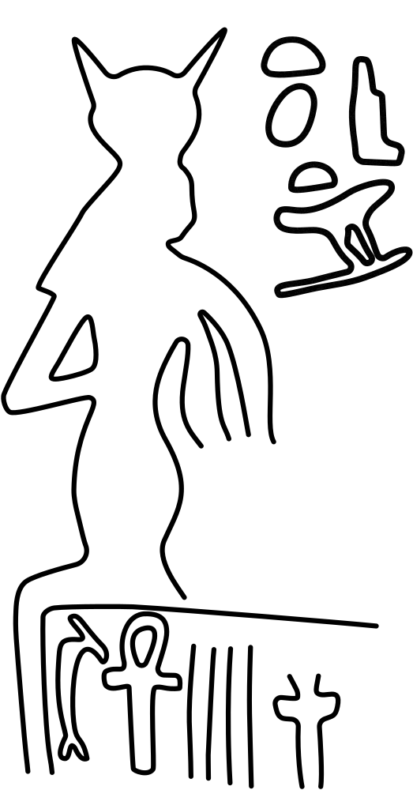
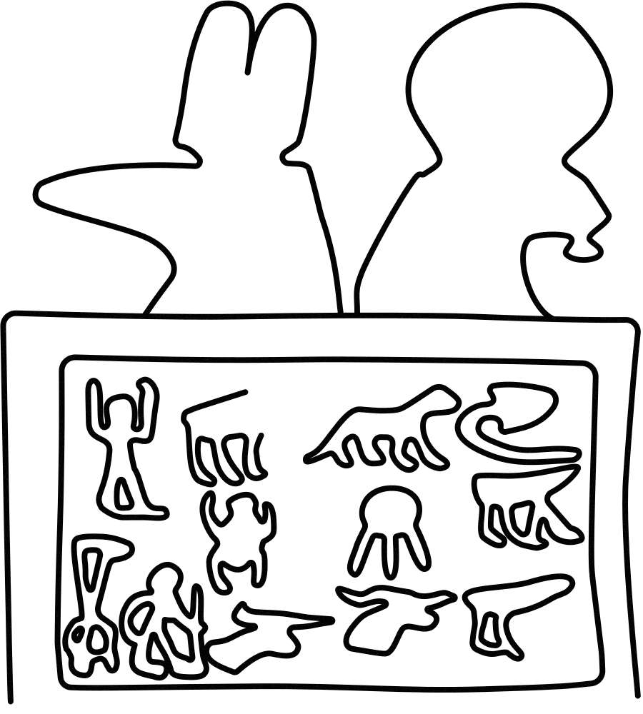
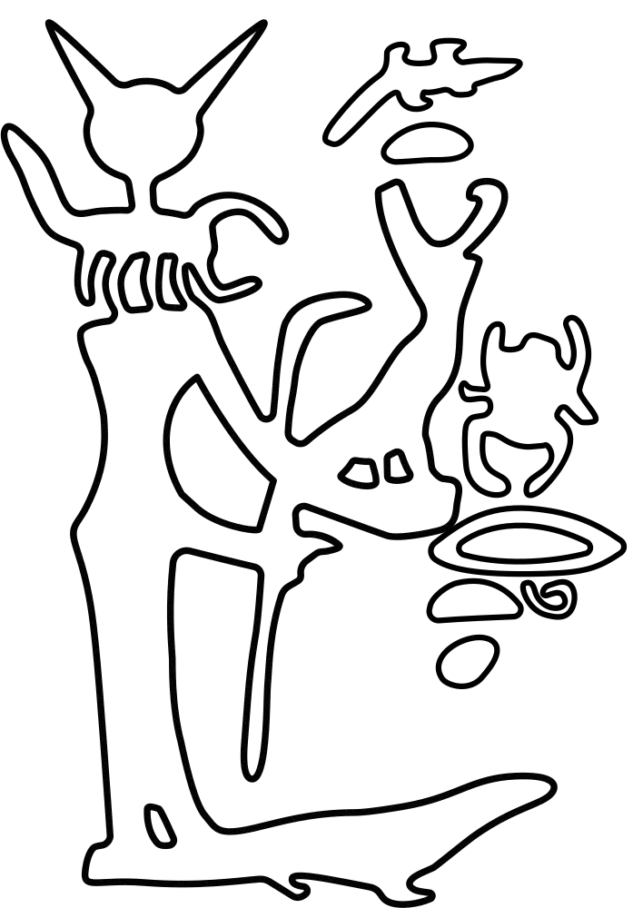

[Zum interaktiven Figurenkatalog](../datenbank.qmd)

## Objektangaben

**Objekttyp:** Standschreitstatue mit Horusstele

**Standort:** Ägyptisches Museum, Kairo

**Inventarnummer:** JE 41677

**Material:** schwarzer Siltstein (Schiefer)

**Herkunft:** Bubastis

**Provenienz:** gefunden 1910, möglw. bei Sebach-Arbeiten

**Datierung:** ca. 360--342 v. u. Z. (wegen Kartusche Nektanebos (II.), 30. Dyn.)

**Erhaltungszustand:** nur Torso erhalten; Teile der rechten Schulter abgebrochen, linke Schulter erhalten; Teile der Vorderseite an der Verschnürung des Schurzes erhalten; Steg zwischen Körper und vmtl. einer Horusstele erhalten;\footnote{Es könnte auch ein Naos mit der Darstellung des Horus auf den Krokodilen sein, wie es bei der Statue Stockholm NME 76 der Fall ist (siehe unten; \citealp{Dils2024}).} Oberarme noch erhalten (Abplatzungen am rechten Oberarm), Unterarme nur ca. zu 30 \% erhalten; Rückenpfeiler erhalten mit Abplatzungen an den Seiten und an der oberen und unteren Kante.

## Figuren

37 Figuren erfasst.

| Zeichnung | Figur-ID | Objektseite | Register | Stelle | Gottheit | Szene |
| --- | --- | --- | --- | --- | --- | --- |
| — | heilstatue:kairoJE41677:31 | Vorderseite | 1 | 1 | Jmn | Anbetung des Amun-Re |
| — | heilstatue:kairoJE41677:32 | Vorderseite | 1 | 2 | Jmn.t | Anbetung des Amun-Re |
| — | heilstatue:kairoJE41677:33 | Vorderseite | 2 | 1 | Ḥḥ | Anbetung des Amun-Re |
| — | heilstatue:kairoJE41677:34 | Vorderseite | 2 | 2 | Ḥḥ.(w)t | Anbetung des Amun-Re |
| — | heilstatue:kairoJE41677:35 | Vorderseite | 1–2 | 3 | Jmn-Rꜥw | Anbetung des Amun-Re |
| — | heilstatue:kairoJE41677:36 | Vorderseite | 1 | 4 | Kk | Anbetung des Amun-Re |
| — | heilstatue:kairoJE41677:37 | Vorderseite | 1 | 5 | Kk.t | Anbetung des Amun-Re |
| — | heilstatue:kairoJE41677:38 | Vorderseite | 2 | 4 | Nwn | Anbetung des Amun-Re |
| — | heilstatue:kairoJE41677:39 | Vorderseite | 2 | 5 | Nw.t | Anbetung des Amun-Re |
| — | heilstatue:kairoJE41677:40 | Rückenpfeiler | 1 | 1 | Ꜣs.t | Isis von Achbit |
| {width=70px} | heilstatue:kairoJE41677:41 | Rückenpfeiler | 2 | 1 | Ḥr.t | Heret |
| {width=70px} | heilstatue:kairoJE41677:42 | Rückenpfeiler | 2 | 2 | Nḫb.t | Nechbet |
| {width=70px} | heilstatue:kairoJE41677:43 | Rückenpfeiler | 2 | 3 | Sbk.t | Sobeket |
| {width=70px} | heilstatue:kairoJE41677:44 | Rückenpfeiler | 3 | 1 | Srq.t | Selket |
| {width=70px} | heilstatue:kairoJE41677:45 | Rückenpfeiler | 3 | 2 | Sḫm.t | Sachmet als Nilpferd |
| {width=70px} | heilstatue:kairoJE41677:46 | Rückenpfeiler | 3 | 3 | Ḫpr.j | Chepri |
| {width=70px} | heilstatue:kairoJE41677:47 | Rückenpfeiler | 4 | 1 | Jh.t | Ihet-weret |
| {width=70px} | heilstatue:kairoJE41677:48 | Rückenpfeiler | 4 | 2 | Srq.t | Selket auf gewundener Schlange |
| {width=70px} | heilstatue:kairoJE41677:49 | Rückenpfeiler | 5 | 1 | Ꜣs.t | Isis, die Krokodil säugt |
| {width=70px} | heilstatue:kairoJE41677:50 | Rückenpfeiler | 5 | 2 | Srp.t-mꜣj-sr; Jtm | Box |
| {width=70px} | heilstatue:kairoJE41677:51 | Rückenpfeiler | 6 | 1 | — | Die mit zahlreichen Gestalten |
| {width=70px} | heilstatue:kairoJE41677:52 | Rückenpfeiler | 6 | 2 | Šw | Schu, der Schlange aufspießt |
| — | heilstatue:kairoJE41677:53 | Rückenpfeiler | 7 | 1 | Ḥr.w | Horus, der Große, der Herr der beiden Messer |
| — | heilstatue:kairoJE41677:54 | Rechte Seite | 1 | 1 | Bꜣs.tt | Adoration vor Gottheiten aus Bubastis |
| — | heilstatue:kairoJE41677:55 | Rechte Seite | 1 | 2 | Rꜥw | Adoration vor Gottheiten aus Bubastis |
| — | heilstatue:kairoJE41677:56 | Rechte Seite | 1 | 3 | Ḥr.j-š⸗f | Adoration vor Gottheiten aus Bubastis |
| — | heilstatue:kairoJE41677:57 | Rechte Seite | 2 | 1 | Ḥr.w | Falke auf Antilope |
| — | heilstatue:kairoJE41677:58 | Rechte Seite | 2 | 2 | Ḏḥw.tj | Thoth, der Herr von Hermopolis, der Herr der Gottesworte |
| — | heilstatue:kairoJE41677:59 | Rechte Seite | 2 | 3 | Mnḫ.t | — |
| — | heilstatue:kairoJE41677:60 | Rechte Seite | 2 | 4 | kꜣ wr | Ka-wer |
| {width=70px} | heilstatue:kairoJE41677:61 | Linke Seite | 1 | 1 | Bꜣs.tt | Adoration vor Gottheiten aus Bubastis |
| {width=70px} | heilstatue:kairoJE41677:62 | Linke Seite | 1 | 2 | Ꜣs.t | Adoration vor Gottheiten aus Bubastis |
| {width=70px} | heilstatue:kairoJE41677:63 | Linke Seite | 1 | 3 | Rꜥw | Adoration vor Gottheiten aus Bubastis |
| — | heilstatue:kairoJE41677:64 | Linke Seite | 2 | 1 | zerstört | zerstört |
| — | heilstatue:kairoJE41677:65 | Linke Seite | 2 | 2 | zerstört | zerstört |
| — | heilstatue:kairoJE41677:66 | Linke Seite | 2 | 3 | — | — |
| — | heilstatue:kairoJE41677:67 | Linke Seite | 2 | 4 | Jmn-Rꜥw | Amun-Re |

## Texte

| Textart | Position (grob) | Literatur |
| --- | --- | --- |
| „Die Hand des Atum“ (Anfang) | Vorderseite + Rechter Arm | Daressy 1911: 188–189; Z. 1–13, 23–29; Dils 2024a |
| „Die Hand des Atum“ (Anfang) | Vorderseite + Rechter Arm | Daressy 1911: 188–189; Z. 1–13, 23–29; Dils 2024a |
| „Die Elle des Heh“ | Vorderseite + Linker Arm | Daressy 1911: 188–189; Z. 30–34; Dils 2024a |
| „Der Nagel des Atum“ | Vorderseite + Linker Arm | Daressy 1911: 188–189; Z. 34–36; Dils 2024a |
| „Der Nagel des Ptah“ | Vorderseite + Linker Arm | Daressy 1911: 188–189; Z. 36–42; Dils 2024a |
| „Bring den Kopf des Horus“ | Vorderseite + Linker Arm | Daressy 1911: 188–189; Z. 42–46; Dils 2024a |
| Text A | Rechte Seite | Daressy 1911: 188–189; Z. B.1–B.3; Dils 2024a |
| „Die Hand des Atum“ (fortgesetzt) | Rückseite | Daressy 1911: 188--189; Z. 1–13, 23–29; Dils 2024a |
| „Die Hand des Atum“ (fortgesetzt) | Rückseite | Daressy 1911: 188--189; Z. 1–13, 23–29; Dils 2024a |
| „Die Hand des Re“ | Rückseite | Daressy 1911: 188--189; Z. 47–52; Dils 2024a |
| „Die Hand des Re“ | Rückseite | Daressy 1911: 188--189; Z. 47–52; Dils 2024a |
| „Die Hand des Re“ | Rückseite | Daressy 1911: 188--189; Z. 47–52; Dils 2024a |

## Maße

| Höhe | Breite | Tiefe | Bemerkungen |
| --- | --- | --- | --- |
| 15.2 | 10.5 | 10 | — |

## Ergänzende Anmerkungen



